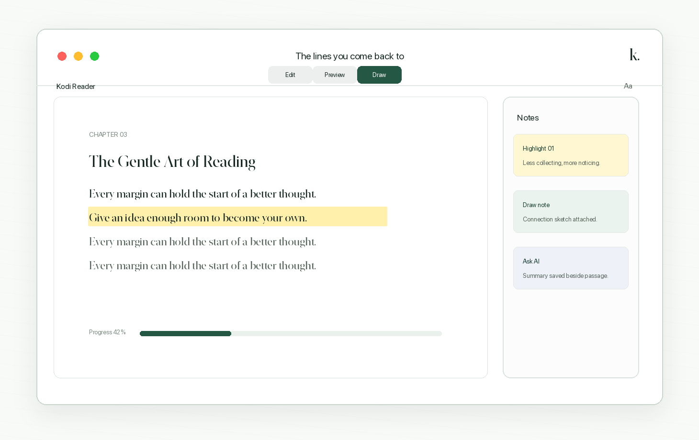
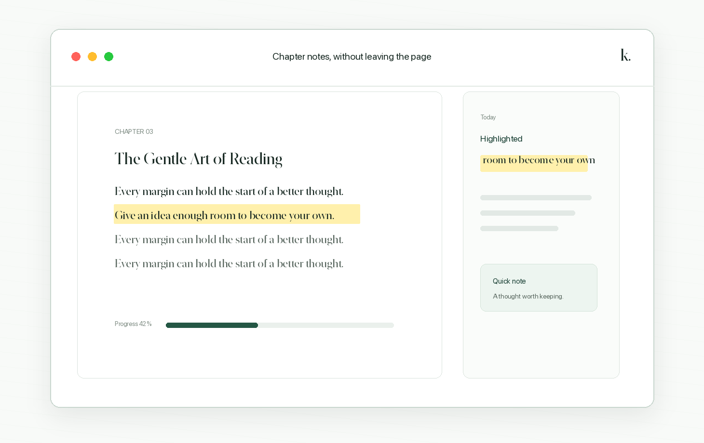
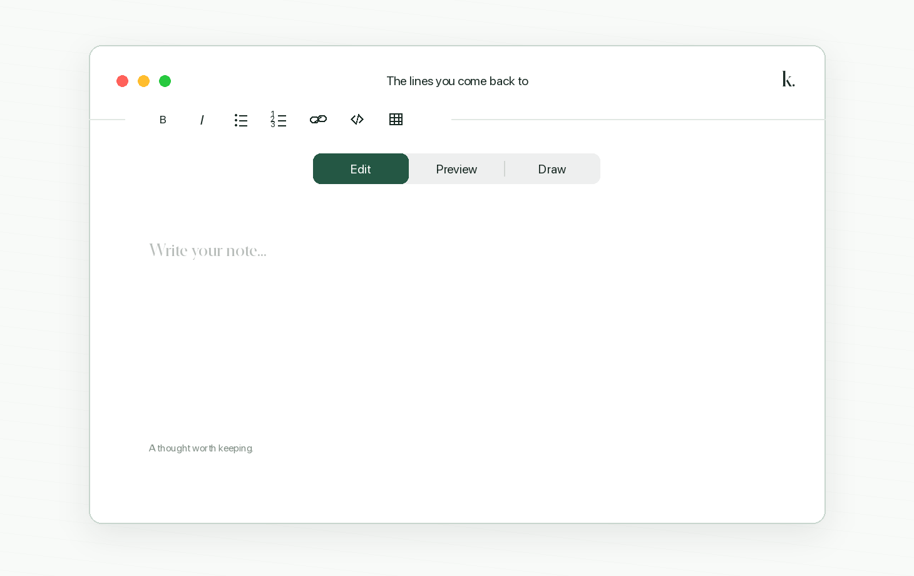
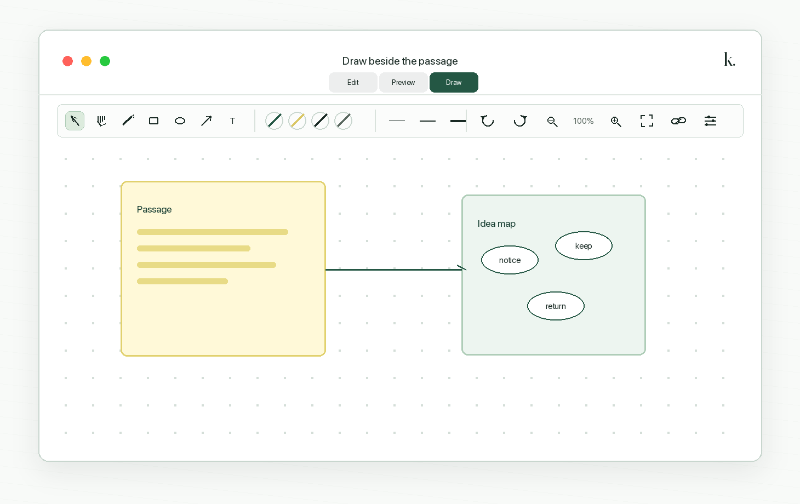
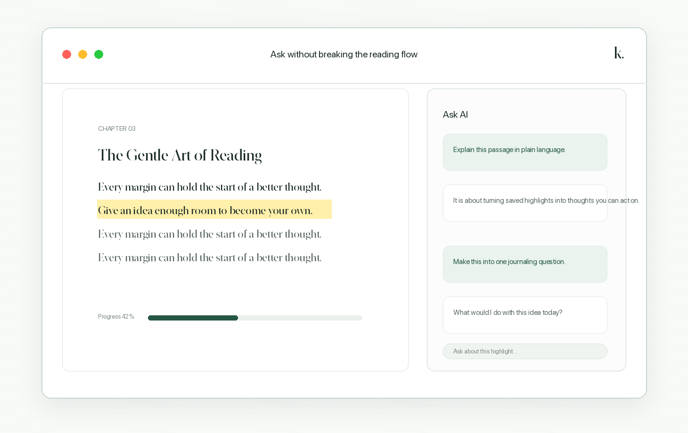

# Kodi Reader

[](LICENSE)

A lightweight native EPUB and PDF reader for macOS. Paginated reading, typography and
theme controls, highlights with notes and drawings, configurable Ask AI, webpage
reading, optional iCloud or Google Drive sync, and a distraction-free interface.



Kodi Reader is **not affiliated with** the [Kodi media center](https://kodi.tv/)
or the XBMC Foundation.

## Features

### Book and document reading
Paginated EPUB rendering with typography, margin, and theme controls, plus native PDF reading with fit-to-page zoom and adaptive two-page spreads. Position and progress survive layout changes and app relaunches.

Click the beginning of a line to place a reading marker; a faint flag appears
there on hover. Or press **M**, then click anywhere in the text where you stopped.
Press **Shift+M** or click **Return to marker** to jump back. Each document keeps
one movable marker across launches and sync; use the marker toolbar menu to
remove it. **Esc** cancels placement. These shortcuts leave typing in notes and
other text fields alone.

Rename a document from its library context menu (**Rename…**) or while reading
with **File → Rename Document…**. The name persists and syncs with book details;
the original file keeps its name, and reading data stays attached.

Following an EPUB reference shows **Back to reading** above the reading footer.
Use it to retrace nested citations and footnotes, or dismiss it with its close
button. Reference jumps pause narration until you press Play.

Search the library by title or author, and sort by title, date added, or date
last read. Use the arrow to reverse the order. Reading filters include Recently
read (the last seven days), In progress, Unread, and Finished. Sort and filter
choices are remembered. Added dates are tracked for new imports; older books
without a recorded added date appear last.



### Listen to EPUBs

Click **Listen** in the macOS reader to open the audio player and listen from
your current passage. Narration continues through chapters, with a spoken
passage cue and optional text following. The bottom player includes a chapter
timeline, 15-second skips, four English voices, and playback speed controls.
Select a passage and choose **Listen from Here** to start at that passage and
continue through the book.
Chapter time remaining is estimated until audio has been generated.
Paradee downloads its model and pronunciation files
on first use, with a separate dictionary for UK voices. Speech runs on your Mac
and works offline after those files are available.

### Daily reading goals
Set a daily goal in **Settings → Reading**, from 5 minutes to 24 hours. Your
goal and streak appear only in Settings by default. Turn on **Show reading goal
and streak** to display them on Home and in the reader toolbar. Meeting the
goal completes the day; you can keep reading, and changing the goal never
removes an earned day. EPUBs, PDFs, and saved articles count while the reader
is in front. Tracking pauses after five minutes without input, when you leave
the reader, or when your Mac sleeps. History stays on this Mac and works with
usage analytics turned off.

### Notes taking
Text highlights in multiple colors, each with an attached note, stored alongside the book.

Export all notes from the notes sidebar’s export menu, or one note from its
**… → Export Note** menu. Choose Markdown (`.md`), Word (`.docx`), Apple Notes
(`.html`), or Notion (`.md`). Each export includes the referenced passage,
chapter, book title, author, and note body. Import the HTML file through
Apple Notes’ **File → Import to Notes**, or the Markdown file through Notion’s
**Settings → Import → Text & Markdown**. Sketches are embedded in Word and HTML;
Markdown and Notion exports include a companion assets folder that must stay
beside the document.



### Visual notes
Multiple freeform sketches in each note via a bundled, offline [Excalidraw](https://excalidraw.com/) editor.
Type `/` at the start of a paragraph to show a **Create sketch · ↵ Enter** suggestion
beside the cursor. Both `/sketch` and `/draw` work; press Enter or click the suggestion
to open the canvas, or Escape to dismiss it. Command–Enter finishes editing the note.
The first saved drawing inserts a preview
card at that position. Click a card to edit its sketch, or use **… → Draw · Sketches**
to browse and rename sketches. Removing the last reference deletes the sketch;
Undo restores its drawing while the note is open. Existing drawings become the
first sketch automatically. Use the updated app on all Macs when syncing sketches.



### Audio notes

Type `/audio` in a note, or choose **Record audio** from the note menu, to record
a thought beside the passage. Allow microphone access when macOS asks. Pause or
resume in the inline recorder, then choose **Done** to save a compact player.
Its menu lets you rename, export, or delete the recording; click the waveform to
seek. Closing a note or book finishes and saves an active take before leaving.
Each card shows its title, recording date, and duration. Choose **Transcribe** to
create text on this Mac, then expand or copy the saved transcript. macOS may
download a speech model the first time; audio is not uploaded for transcription.
Recordings follow your existing notes sync setting and are included in note
exports as `.m4a` files in a companion assets folder. Keep that folder beside
the exported document. Saved transcripts sync with the note and appear in note
exports. Use the updated app on all Macs editing audio notes.

### Research reminders

Select a passage and choose **Remind** to open **Add Reminder**. The title starts
with your selected text; rewrite it to describe what you want to research, then
click **Add Reminder**. The original passage stays attached as context. A small
magnifying-glass marker beside the passage shows unfinished research; click it
to view, edit, or complete the reminder. Completed reminders leave the page clear.
Use the reader’s
**Reminders** menu to add a reminder for the current page without selecting text.
In a note, type `/remind Research database sharding` or `/task Research database
sharding`, then press Enter. A bare `/remind` opens a topic field. Reminders appear
as linked rows in notes, with a checkbox for completion.

Open **Reminders** from Home, the reader sidebar, or **View → Research Reminders**
(**⌘⇧R**) to search across books, edit topics, complete tasks, and return to their
source. The list has Open and Completed views. Removing a source note or downloaded
book keeps its reminders; deleting the book and its reading data removes them.
These are research tasks without scheduled notifications.

Reminders work offline and sync with notes through iCloud or Google Drive when
enabled. Older app versions do not show reminders; update all Macs before managing
books with reminders across devices.

### Ask AI
Opt-in OpenAI-powered chat about the book, with per-book chat threads and surrounding-passage context sent for better answers. Quick prompt badges and personal saved prompts make recurring questions easier to ask.



### Cloud sync
Settings → Sync offers Off (the default), iCloud, or Google Drive, with one
provider active per Mac. Choose Notes only or Books and notes; saved Ask AI
history has a separate opt-in toggle. Book files download when opened or through
Download for Offline Reading. Switching providers requires a confirmed copy of
this Mac's library; the old cloud copy remains. See [iCloud help](docs/icloud-sync.md),
[Google Drive help](docs/google-drive-sync.md), and their release setup guides.

## iOS app

[`Mobile/`](Mobile/README.md) holds an iOS-first port built with Expo SDK 57,
Expo Router, `@expo/ui` SwiftUI components and Liquid Glass. It hosts the same
`reader.js`/`reader.css` engine in a `WKWebView`, so positions and highlights
share the Mac app's anchor format. See its README for building with Xcode 26.

## Status

Source is public under MIT. Issues are welcome for bugs. **Pull requests are
not the goal right now** — this is a source-available personal project, not a
contributor funnel. See [NOTICE.md](NOTICE.md) for third-party licenses and
[SECURITY.md](SECURITY.md) to report vulnerabilities privately.

For implementation details, see [How Kodi Reader works](docs/how-it-works.md).

A macOS disk image is published on [GitHub Releases](https://github.com/dev-olly/kodi-reader/releases/latest). Release builds are signed with Developer ID and notarized by Apple. You can also build from source (Xcode 16.3 or later).

The site is deployed on Vercel at [www.kodi-reader.app](https://www.kodi-reader.app/).
The linked Vercel project's **Root Directory must be `website`**, with the Other
framework preset. Git deployments then use `website/vercel.json` and serve only
the static site. Deploying the repository root puts the homepage under `/website/`
and leaves `/` returning 404. After production deployments, verify the homepage,
its assets, and the download link on both the apex and `www` domains.

## Privacy

- Books, PDFs, highlights, notes, and drawings are stored on this Mac (Application
  Support). Optional sync stores selected categories in either the user's
  private iCloud database or hidden Google Drive app-data folder, using their
  respective storage allowance. EPUBs are read directly from their archives and PDFs
  remain byte-for-byte unchanged; Kodi annotations are stored separately.
- Release builds share limited usage analytics by default. Settings → Privacy
  lets you turn this off and clear unsent events. A random installation ID,
  app version, event type, engagement duration, and approximate upload country
  help measure active devices, reader engagement, meaningful note/drawing edits,
  reminders, audio recording, text-to-speech listening, and Ask AI use.
  Engagement includes reading, notes, drawing and Ask AI while
  the reader is active, excluding idle time. No GPS access is requested. These
  statistics are pseudonymous. Book titles, passages, questions, notes, reminder
  text, recordings, spoken text, email addresses, and webpage URLs are not
  included or linked to these events.
  Debug builds do not send analytics. See [analytics setup](docs/analytics.md)
  for the private dashboard and deployment instructions.
- **Ask AI** is opt-in. Quoted passages and chat are sent to the hosted Kodi AI
  proxy, which forwards requests to OpenAI. The OpenAI API key lives only on the
  server, never in the Mac app. Kodi AI uses a stronger default model tuned for
  simple explanations with references to the passages you attach.
- Ask AI requires email-code sign-in through Supabase. Supabase stores the account
  email and authentication records; the configured email provider delivers login codes.
  Session tokens stay in macOS Keychain. The AI proxy validates the session and applies
  temporary per-account/IP request limits; it does not log tokens or book passages.
  Sign out or delete the account from the Ask AI account menu. Local books, notes, and
  conversations remain on this Mac after either action.
- Opened webpages are fetched and converted locally. There are no extra
  network calls beyond the page itself.

## Requirements

- macOS 15 or later
- Xcode 16.3 or later (Swift 6.1 is required by the authentication SDK)
- [XcodeGen](https://github.com/yonaskolb/XcodeGen) to generate the project file
- Node.js/npm only when changing the bundled Excalidraw drawing host

```sh
brew install xcodegen
```

## Setup

For hosted Ask AI, follow [the email authentication setup guide](docs/ask-ai-auth-setup.md).
Without Supabase configuration the reader works normally, but AI sign-in is unavailable.

### Install the app

Kodi Reader checks for updates quietly on launch and daily. An **Update available**
button appears in the home header and reading/browser toolbar only when a new version
is available. Click it to download, then **Restart to update** when ready. Choose
**Kodi Reader → Check for Updates…** to check manually. **Settings → Updates** controls automatic checks
and optional automatic downloads/installations. Updating keeps local reading data.
Users on v0.3.0 or earlier need to install v0.3.1 manually once to get the updater.

Download `KodiReader.dmg` from
[GitHub Releases](https://github.com/dev-olly/kodi-reader/releases/latest),
open it, and drag `Kodi Reader.app` into Applications.

Current releases are signed with Developer ID and notarized by Apple. macOS
will still show its normal confirmation the first time an Internet-downloaded
app is opened.

### Build from source

Clone the repository and install XcodeGen:

```sh
git clone https://github.com/dev-olly/kodi-reader.git
cd kodi-reader
brew install xcodegen
```

Debug builds use ad-hoc signing so they run locally without distribution
credentials. Release builds require the project's Developer ID certificate.
Ordinary builds omit Finder document handlers, including local Release builds.
`package-dmg.sh` opts into EPUB/PDF registration for the distributed app and
removes its loose app copies even if packaging fails. It preserves release metadata
in `.build/release-info.plist` for appcast generation.
After an installed release launches (including after a Sparkle update), it
unregisters development copies, missing bundles, and older or equal-version Kodi
and legacy Folio copies, then registers itself. Newer copies in Applications
are left alone. Sparkle replaces the previous installed release in place;
registration cleanup does not delete other installations or reader data.
Old generated app bundles that still declare EPUB/PDF support must be removed
or archived as ZIPs once; merely unregistering a loose `.app` allows macOS to
discover its document handlers again.
On a machine with multiple Xcode versions, point the shell at the Xcode you want:

```sh
export DEVELOPER_DIR=/Applications/Xcode.app/Contents/Developer
```

Generate the Xcode project and open it:

```sh
xcodegen generate
open KodiReader.xcodeproj
```

For local testing, use the single debug launcher:

```sh
bash Scripts/run-debug.sh
```

It rebuilds and opens `.xcode-derived-data/Build/Products/Debug/Kodi Reader Debug.app`,
with code signing disabled. It first quits any running Kodi Reader normally so
notes finish saving before the debug app opens the same library. Reuse this
launcher rather than making additional test app copies. The installed release
in Applications remains available separately.

The `.xcodeproj` is generated from `project.yml` and is not committed, so
regenerate it after pulling changes that touch the project layout.

The bundle identifier is `com.olly.KodiReader`. Product name lives in
`project.yml` as `PRODUCT_NAME: Kodi Reader`.

### Brand assets

The shared logo master is [`website/assets/kodi-logo.svg`](website/assets/kodi-logo.svg).
It uses solid forest green (`#245744`) and a white k with an upward-turning page.
To regenerate the macOS app icon, welcome-screen image, website PNGs, and favicons
after editing the master, run on macOS:

```sh
swift Scripts/generate-brand-assets.swift
```

Generated assets are committed, so normal builds do not need this step.

### Publish in-app updates

The app uses [Sparkle](https://sparkle-project.org/documentation/) with a signed
`appcast.xml` served from this repository's `main` branch. Sparkle 2.10.0 is pinned
in `project.yml`; update archives and the feed both require Ed25519 signatures.
The private signing key stays in the release Mac's login Keychain under account
`com.olly.KodiReader`. Only `SUPublicEDKey` is committed. Preserve this Keychain
key when moving release machines; never commit or publish the private key.

For each release:

1. Increase **both** `MARKETING_VERSION` and the integer `CURRENT_PROJECT_VERSION`
   in `project.yml`, and write `docs/releases/<version>.md`.
2. Run `./Scripts/package-dmg.sh --notarize`.
3. Run `./Scripts/generate-appcast.sh` to generate and sign the feed using Sparkle.
   The tool embeds release notes and checks the signing key and notarization ticket.
4. Publish `KodiReader.dmg` to the matching GitHub release (`v<version>`).
5. Commit and push `appcast.xml` **after** the download is public. Installed apps
   can then discover the update. Do not edit the signed feed by hand.

Every DMG uses `Release-iCloud` so an update preserves existing iCloud sync.
Packaging requires the Developer ID iCloud provisioning profile and checks that
both the built app and final staged app enable iCloud and carry valid Production
CloudKit entitlements. The older `--icloud` flag is still accepted. Use Xcode's
ordinary `Debug` or `Release` configurations for local builds without iCloud;
see the [iCloud signing setup](docs/icloud-sync-setup.md).

The DMG script signs Sparkle's nested helpers before signing the outer app.
Debug builds enable Sparkle's sandbox installer service; Release builds are
unsandboxed and use the normal installer. Development-only library-validation
exceptions are kept out of Release entitlements.

## Testing

```sh
./Scripts/fetch-samples.sh   # downloads three Project Gutenberg books
swift test
```

`EpubKitTests` covers container and metadata parsing against real books;
`ReaderUITests` drives a live `WKWebView` through the whole rendering path and
asserts that pagination, page turns, progress, and position restoring all work.
Tests skip rather than fail if the sample books have not been downloaded.

### Looking at pages

```sh
swift test --filter SnapshotTests
open Snapshots/
```

This renders real pages to PNGs in `Snapshots/` using `WKWebView.takeSnapshot`,
covering every theme, a two-column spread, the typography extremes, and
highlights on both light and dark backgrounds. It captures the web view's own
output in-process, so it needs no screen recording permission and shows what
the reader actually draws rather than whatever is on the display.

It is worth doing after any change to `reader.css`. Assertions cannot tell you
that a page is *ugly*, and a theme bug that made dark mode black-on-black
passed every functional test before the snapshots exposed it.

## Rebuilding the Excalidraw host

The drawing editor is a bundled, offline Excalidraw build. npm is only needed
when changing that host:

```sh
cd Tools/excalidraw-host
npm ci
npm run build
```

That writes static assets into `Sources/ReaderUI/Resources/Excalidraw/`. Commit
those generated files so the app builds without Node.

## Not included

No library shelf, DRM/LCP, OCR, password-protected PDF support, sync, OPDS
catalogues, bundled audiobooks, or fixed-layout EPUB. EPUBs and PDFs are opened
with `Cmd-O` or by dropping them on the window. The welcome screen lists what
you were reading recently.
